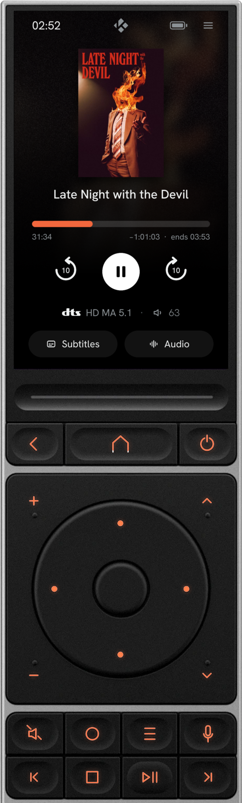
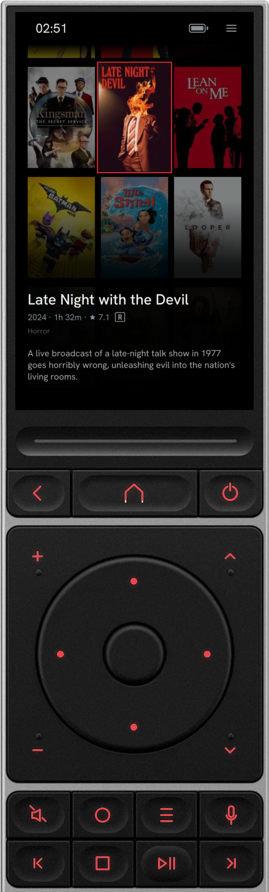
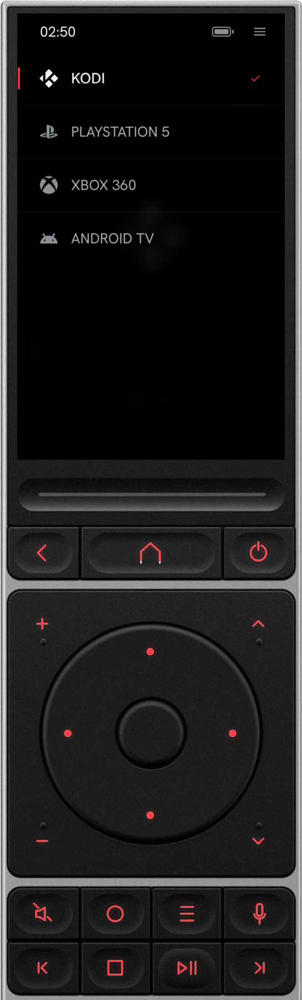
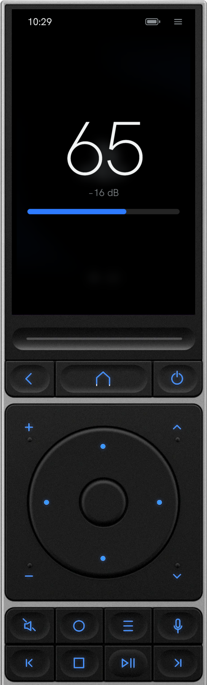
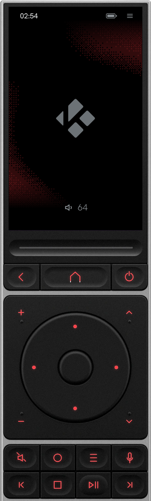

<p align="center">
  <picture>
    <source media="(prefers-color-scheme: dark)" srcset="docs/images/logo-dark.svg">
    <source media="(prefers-color-scheme: light)" srcset="docs/images/logo.svg">
    
  </picture>
</p>

<p align="center">
  A simplified <a href="https://www.unfoldedcircle.com/">Unfolded Circle Remote 3</a> interface for your big ass home theater setup
</p>

<p align="center">
  <a href="https://www.unfoldedcircle.com/"></a>
  <a href="LICENSE"></a>
  <a href="https://github.com/jackhric/r3cui/releases"></a>
  
  <a href="https://www.rust-lang.org"></a>
  <a href="https://slint.rs"></a>
</p>

<p align="center">
  <a href="#features">Features</a> ·
  <a href="#getting-started">Getting started</a> ·
  <a href="#go-back-to-the-normal-ui">Uninstall</a>
</p>

<p align="center">
  <a href="docs/images/screenshots/now-playing.png"></a>
  <a href="docs/images/screenshots/poster-wall.png"></a>
  <a href="docs/images/screenshots/inputs.png"></a>
  <a href="docs/images/screenshots/volume.png"></a>
  <a href="docs/images/screenshots/home.png"></a>
</p>

## Features

- Dead nuts simple and single purpose remote frontend
- Deep [Kodi](https://kodi.tv) integration: control playback, audio tracks, subtitles, etc. easily
- Easy input switching for receivers
- Global volume controls
- Reactive and dynamic backlighting depending on input, currently playing media, etc.

## Beta software

This is beta software. Things may break, and things are 100% bound to change.

r3cui works closely with [Kodi](https://kodi.tv) and [Home Assistant](https://www.home-assistant.io).
It is not plug and play yet. You'll need to clone the project and modify it to suit your home
theater configuration and setup.

## Warranty

These be treacherous waters. Ye be warned!

**Installing r3cui voids your Remote 3 warranty.** The remote keeps a permanent record that a custom
screen was installed. That record stays even if you go back to the Normal UI.

## Getting started

### Requirements

- An [Unfolded Circle Remote 3](https://www.unfoldedcircle.com/) with firmware 2.8.4 or
  newer (the version r3cui is tested on).
- [Kodi](https://kodi.tv) and [Home Assistant](https://www.home-assistant.io), both already set up
  on your remote.
- A receiver (amplifier) that Home Assistant can control.
- A computer on the same network as the remote.
- Your remote's IP address and web configurator PIN. You can find both in the remote's settings.

### 1. Download

Download `remote-ui.tar.gz` from the [Releases](https://github.com/jackhric/r3cui/releases) page.

### 2. Install

Open a terminal in the folder with the file and run this command. Put your PIN and IP address in
place of `<PIN>` and `<IP>`.

```sh
curl -u 'web-configurator:<PIN>' \
  'http://<IP>/api/system/install/ui?void_warranty=yes' \
  --form 'file=@remote-ui.tar.gz'
```

### 3. Wait

Wait for the remote to show the new screen. If it does not, restart the remote.

## Go back to the Normal UI

```sh
curl -u 'web-configurator:<PIN>' -X PUT 'http://<IP>/api/system/install/ui?enable=false'
```

To remove r3cui completely:

```sh
curl -u 'web-configurator:<PIN>' -X DELETE 'http://<IP>/api/system/install/ui'
```

If r3cui fails to start many times in a row, the remote goes back to the Normal UI by itself.

## Credits

r3cui stands on the shoulders of the existing Remote 3 integrations:

- [Kodi integration](https://github.com/albaintor/integration-kodi) by [@albaintor](https://github.com/albaintor)
- [Home Assistant integration](https://github.com/unfoldedcircle/integration-home-assistant) by
  [@zehnm](https://github.com/zehnm) and [Unfolded Circle](https://github.com/unfoldedcircle)

## AI Disclaimer

This project was built with heavy use of [Claude Code](https://claude.com/claude-code).

## License

[GPL-3.0](LICENSE)

r3cui is not made by [Unfolded Circle](https://www.unfoldedcircle.com) and is not supported by them.
